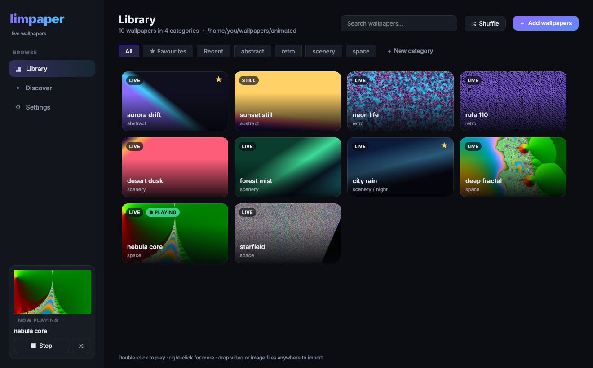
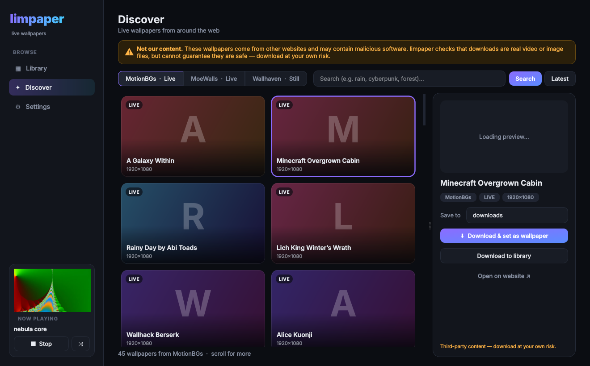
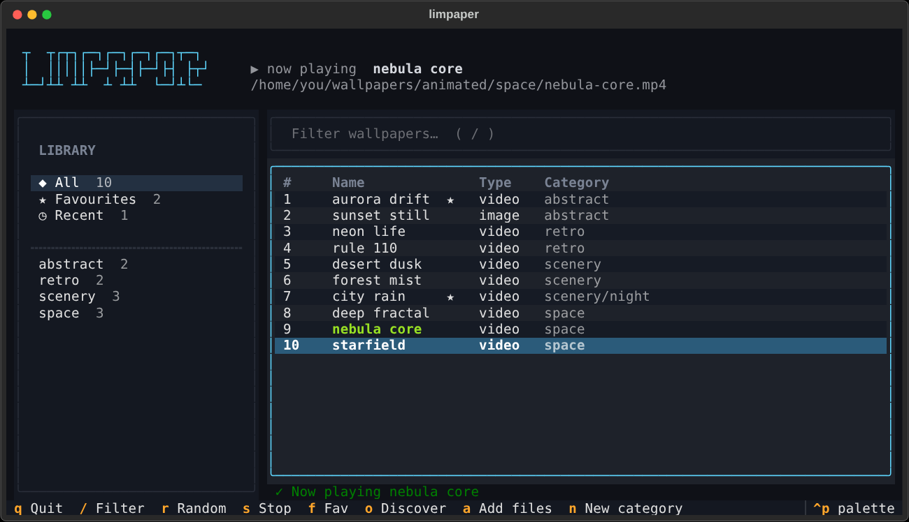
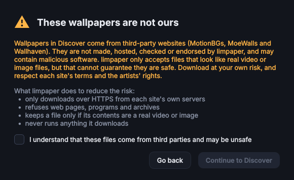

# limpaper

Live wallpapers for Linux and Windows. Keep your videos in folders, pick one in a sleek GUI or a fast
terminal UI, and it plays as your desktop background. You can also browse and download new live
wallpapers from the web without leaving the app.



- **GUI**: a dark, card-based library with thumbnails, categories, favourites, search, drag and drop,
  and a now-playing card.
- **TUI**: the same library from the keyboard, built on [Textual](https://textual.textualize.io).
- **Discover**: browse, preview and download wallpapers from MotionBGs, MoeWalls and Wallhaven,
  in the GUI, the TUI or the CLI.
- **CLI**: every action is also a command, for keybinds and autostart.
- **Desktop colours** (Linux, optional): recolour your desktop from each wallpaper through
  [caelestia](https://github.com/caelestia-dots).

> [!WARNING]
> **Wallpapers in Discover are not ours.** They come from third-party websites, are not made,
> hosted or checked by limpaper, and **may contain malicious software**. limpaper only keeps files
> that are real videos or images (see [what it checks](#discover-online-wallpapers)), but that cannot
> guarantee a file is safe. Download at your own risk, and respect each site's terms and the
> artists' rights.

## Contents

- [Install](#install): [Windows](#windows) · [Arch Linux](#arch-linux) · [Debian / Ubuntu](#debian--ubuntu) · [From source](#from-source)
- [Using limpaper](#using-limpaper): [GUI](#gui) · [TUI](#tui) · [Commands](#commands)
- [Adding wallpapers](#adding-wallpapers)
- [Discover (online wallpapers)](#discover-online-wallpapers)
- [Desktop colours](#desktop-colours-linux)
- [Configuration](#configuration) · [Files](#files) · [Limitations](#limitations)

## Install

### Windows

**[⬇ Download the installer (limpaper-setup-windows-x64.exe)](https://github.com/Chummychum4/limpaper/releases/latest/download/limpaper-setup-windows-x64.exe)**

or the **[portable zip](https://github.com/Chummychum4/limpaper/releases/latest/download/limpaper-windows-x64-portable.zip)**
(unzip anywhere and run `limpaper.exe`). All builds are on the [Releases page](https://github.com/Chummychum4/limpaper/releases).

- The installer is per-user, so it needs no administrator rights. It adds a Start menu entry and
  can optionally restore your wallpaper at login.
- [mpv](https://mpv.io) is bundled. Videos play behind your desktop icons on Windows 10 and 11.
- `limpaper-cli.exe` in the install folder runs the TUI (`limpaper-cli tui`) and the commands below.
- The builds are not code-signed yet, so SmartScreen may show "Windows protected your PC". Click
  **More info → Run anyway** if you trust this repository.

### Arch Linux

One command installs everything, including mpvpaper (from the repos, your AUR helper, or the AUR
directly):

```sh
curl -fsSL https://raw.githubusercontent.com/Chummychum4/limpaper/main/install.sh | bash
```

<details>
<summary>Or as a pacman package (PKGBUILD)</summary>

```sh
yay -S mpvpaper                 # mpvpaper may only be in the AUR
git clone https://github.com/Chummychum4/limpaper.git
cd limpaper/packaging/arch
makepkg -si
sudo pacman -S --needed pyside6 qt6-multimedia-ffmpeg python-textual ffmpeg python-pillow
```
</details>

<details>
<summary>Or by hand</summary>

```sh
sudo pacman -S --needed python mpv ffmpeg python-pillow pyside6 qt6-multimedia-ffmpeg python-textual
yay -S mpvpaper
python -m venv --system-site-packages ~/.local/share/limpaper/venv
~/.local/share/limpaper/venv/bin/pip install https://github.com/Chummychum4/limpaper/archive/main.tar.gz
ln -s ~/.local/share/limpaper/venv/bin/limpaper ~/.local/bin/limpaper
```
</details>

### Debian / Ubuntu

The same command works on Debian, Ubuntu, Mint, Pop!_OS and their relatives. mpvpaper is built from
source when your release does not package it:

```sh
curl -fsSL https://raw.githubusercontent.com/Chummychum4/limpaper/main/install.sh | bash
```

<details>
<summary>Or by hand</summary>

```sh
sudo apt install python3 python3-venv mpv ffmpeg python3-pil libegl1 libxkbcommon-x11-0 libxcb-cursor0

# mpvpaper: use the package if your release has one…
sudo apt install mpvpaper
# …otherwise build it
sudo apt install build-essential meson ninja-build pkg-config git \
                 libmpv-dev libwayland-dev libwayland-bin wayland-protocols libegl-dev
git clone https://github.com/GhostNaN/mpvpaper.git && cd mpvpaper
meson setup build && ninja -C build && sudo ninja -C build install && cd ..

python3 -m venv ~/.local/share/limpaper/venv
~/.local/share/limpaper/venv/bin/pip install "limpaper[all] @ https://github.com/Chummychum4/limpaper/archive/main.tar.gz"
ln -s ~/.local/share/limpaper/venv/bin/limpaper ~/.local/bin/limpaper
```
</details>

#### Installer options

Pass options after `bash -s --`, e.g. `curl -fsSL …/install.sh | bash -s -- --no-gui`:

| Option | Effect |
| --- | --- |
| `--no-gui` | skip the GUI (PySide6) |
| `--no-tui` | skip the TUI (Textual) |
| `--no-mpvpaper` | do not install or build mpvpaper |
| `--ref <branch or tag>` | install something other than `main` |
| `--uninstall` | remove limpaper; your wallpapers and settings are kept |

The installer puts limpaper in a virtual environment under `~/.local/share/limpaper`, links the
`limpaper` command into `~/.local/bin`, and adds an app-menu entry. Run `limpaper doctor` to check
the setup.

**Linux requirement:** a wlroots-based Wayland compositor such as Hyprland, Sway or river. mpvpaper
draws through `wlr-layer-shell`, which GNOME and KDE do not implement.

### From source

```sh
pip install "limpaper[all] @ git+https://github.com/Chummychum4/limpaper.git"
```

The extras are `tui` (Textual), `gui` (PySide6), `preview` (animated previews in the GUI) and
`all`. The core and CLI need nothing beyond the Python standard library.

## Using limpaper

Run `limpaper` with no arguments: you get the TUI in a terminal and the GUI everywhere else (app
menu, keybind, the Windows `.exe`). Use `limpaper gui` or `limpaper tui` to choose.

### GUI

| | |
| --- | --- |
| **Library** | Every wallpaper as a card. Category chips across the top: **All**, **★ Favourites**, **Recent**, then your folders. **Double-click** a card to play it; **right-click** to favourite, move, reveal or delete it. **Drop files or folders** anywhere on the window to import them into the current category. Right-click a category chip to rename, open or delete it. |
| **Discover** | Pick a source, search or browse the latest, and select a card to see an animated preview. **Download & set as wallpaper** does both in one click. Scroll down to load more. |
| **Settings** | Wallpaper folder, download category, mpv options, monitor, restore at login, desktop colours, safe search and previews. |
| **Sidebar** | What is playing now, with **Stop** and **Shuffle**. |

Shortcuts: `Ctrl+1/2/3` switch pages · `Ctrl+F` search · `Ctrl+R` random wallpaper · `F5` rescan.



*(Thumbnails are replaced with placeholders in this screenshot; in the app you see each site's previews.)*

### TUI



| Key | Action |
| --- | --- |
| `↑ ↓` / mouse | move; the left list picks a category, the right one a wallpaper |
| `Tab` | switch between the category list, filter and wallpaper list |
| `Enter` | play the selected wallpaper |
| `/` | filter by name (`Esc` clears) |
| `r` | random wallpaper from the current view |
| `s` | stop the wallpaper |
| `f` | toggle favourite |
| `a` | add files or a folder to the current category |
| `n` | new category |
| `m` / `Delete` | move / delete the selected wallpaper |
| `o` | **Discover**: browse and download online wallpapers |
| `F5` | rescan |
| `q` | quit |

In Discover: `Enter` downloads and plays, `d` only downloads, `m` loads more results, `w` opens the
page in your browser, `/` searches, `Esc` goes back.

### Commands

```
limpaper                      TUI in a terminal, GUI otherwise
limpaper gui | tui            choose explicitly
limpaper list [category]      print categories and wallpapers
limpaper apply <name|path>    play a wallpaper ("neon grid", "cars/r31.mp4" or a path)
limpaper random [category]    play a random wallpaper
limpaper restore              re-apply the last wallpaper (use this at login)
limpaper stop                 stop the wallpaper and restore your colours
limpaper current              print the current wallpaper's path
limpaper add <files…> [-c category] [--move]
limpaper sources              list online sources
limpaper online <source> [search words] [--page N] [--get N [--apply]] [-c category]
limpaper doctor               check dependencies and setup
```

The 1.x flags still work: `-l` list, `-r` restore, `-R` random, `-s` stop, `-c` current.

#### Restore at login

Turn on **Settings → Restore my wallpaper when I log in**. On Windows this adds a startup entry.
On Linux it writes an XDG autostart entry, which most desktops honour. Hyprland and Sway ignore those
by default, so add this to your compositor config instead:

```
exec-once = ~/.local/bin/limpaper restore        # Hyprland
exec ~/.local/bin/limpaper restore               # Sway
```

#### A keybind

Compositors do not read your shell's `PATH`, so use the full path:

```
bind = SUPER, G, exec, ~/.local/bin/limpaper gui        # Hyprland: the GUI
bind = SUPER SHIFT, G, exec, foot ~/.local/bin/limpaper  # the TUI in foot
bind = SUPER, R, exec, ~/.local/bin/limpaper random      # shuffle
```

## Adding wallpapers

Wallpapers are plain files in category folders under your wallpaper folder. The default is
`~/wallpapers/animated` on Linux and `%USERPROFILE%\Videos\limpaper` on Windows:

```
~/wallpapers/animated/
├── abstract/
├── cars/
├── scenery/
│   └── night/        ← sub-folders are listed inside their category
└── downloads/        ← where Discover saves by default
```

Any way of getting files there works:

- **GUI:** drag files or whole folders onto the window, or click **＋ Add wallpapers**.
- **TUI:** press `a` and type a path (a file or a folder).
- **CLI:** `limpaper add ~/Downloads/*.mp4 -c scenery`
- **Discover:** download from the online sources (below).
- **File manager:** copy files in. limpaper notices new folders and files automatically.

Formats: videos `mp4 mkv webm gif mov avi m4v`; stills `jpg jpeg png webp bmp`.

## Discover (online wallpapers)

> [!CAUTION]
> These wallpapers are made and hosted by **other websites, not by limpaper**, and **may contain
> malicious software**. The app shows this warning before you first open Discover, keeps a banner
> on the page, and prints it in the CLI. You can show the first-run warning again from Settings.

<p align="center"></p>

| Source | Kind | What you get |
| --- | --- | --- |
| [MotionBGs](https://motionbgs.com) | Live | Games, anime and film wallpapers; 1080p MP4 downloads and animated previews |
| [MoeWalls](https://moewalls.com) | Live | Mostly anime and games; the original MP4 and animated previews |
| [Wallhaven](https://wallhaven.cc) | Still | A huge library of images through the official API; safe-for-work only unless you turn safe search off |

limpaper keeps a download only when **all** of these hold:

- it came over **HTTPS** from that site's own domains, including after any redirect;
- the server did not label it as a web page, program, script or archive;
- its **first bytes are a real video or image container** (MP4/MOV, WebM/MKV, AVI, GIF, JPEG, PNG,
  WebP, BMP). Anything else, such as a Windows program or a zip, is deleted;
- it is under 2 GB.

limpaper never opens or runs a downloaded file. It only hands videos to mpv, the same as playing a
file yourself. These checks reduce the risk; they do not remove it. Keep your system and mpv up to
date. The sites are scraped from their public pages, so a site redesign can break a source until
limpaper is updated.

## Desktop colours (Linux)

When you play a wallpaper, limpaper can extract a frame, hand it to `caelestia wallpaper -f` and
switch caelestia to its `dynamic` scheme. Your terminals, bar, GTK, Qt, fuzzel and btop then match
the wallpaper, and bright wallpapers flip you to light mode. This needs `caelestia-cli` and
`ffmpeg`. Without them limpaper skips this step quietly. Turn it off in Settings or with
`LIMPAPER_THEME=0`.

The first time colours change, your scheme is saved to `~/.local/state/limpaper/baseline`, and
`limpaper stop` puts it back. Videos that fade in from black are re-sampled further in (this needs
Pillow). If a video's first frame is not representative, set **Sample colours at** (or
`LIMPAPER_FRAME_AT=3`) to use a later frame.

## Configuration

Settings are edited in the GUI and stored in `~/.config/limpaper/config.json`
(`%APPDATA%\limpaper\config.json` on Windows). The 1.x environment variables still work and override
the file for that run:

| Variable | Setting | Default |
| --- | --- | --- |
| `LIMPAPER_DIR` | wallpaper folder | `~/wallpapers/animated` |
| `LIMPAPER_OUTPUT` | mpvpaper output, e.g. `DP-1` | `*` (all monitors) |
| `LIMPAPER_THEME` | `0` leaves colours alone | `1` |
| `LIMPAPER_FRAME_AT` | seconds into the video to take colours from | first frame |
| `LIMPAPER_MPV_OPTS` | mpv options | `no-audio loop panscan=1.0 hwdec=auto` |
| `LIMPAPER_MPV` | path to `mpv.exe` (Windows) | auto-detected |

`panscan=1.0` fills the screen instead of letterboxing.

## Files

| Linux | Windows | Contents |
| --- | --- | --- |
| `~/.config/limpaper/config.json` | `%APPDATA%\limpaper\config.json` | settings |
| `~/.local/state/limpaper/current` | `%LOCALAPPDATA%\limpaper\current` | last wallpaper (same file as 1.x) |
| `~/.local/state/limpaper/history.json`, `favorites.json` | same folder | Recent and Favourites |
| `~/.local/state/limpaper/baseline` | — | colour scheme to restore |
| `~/.cache/limpaper/` | `%LOCALAPPDATA%\limpaper\cache\` | thumbnails and frames; safe to delete |

## Limitations

- One wallpaper across all monitors. On Windows the video spans the whole virtual desktop.
- Linux playback needs a wlroots compositor (see above). GNOME and KDE are not supported.
- Online sources depend on each site's current layout.

## Development

```sh
pip install -e ".[all]" pytest
pytest
```

The code is in `src/limpaper`: `library`, `core` and the `backends` are shared by `cli`, `tui` and
`gui`, and online sources live in `sources/`. To publish a release, bump `__version__` in
`src/limpaper/__init__.py` and push a tag such as `v2.0.0`. The *Release* workflow builds the
Windows installer and portable zip, bundles mpv, and attaches them and `install.sh` to a GitHub
release. Running the workflow by hand builds the same files as an artifact without releasing.

## Licence

GPL-3.0-or-later. See [LICENSE](LICENSE). The Windows build bundles [mpv](https://mpv.io)
(GPLv2+/LGPLv2.1+) unmodified.
